# 🎮 Kế Hoạch Cải Thiện & Nâng Cấp Hệ Thống Fighting Game

> **Phiên bản:** 1.0  
> **Phạm vi:** Combat Feel, AI Reaction, Settings Persistence, Economy & Progression, Training Mode, SFX Optimization. *(Phần LAN PvP đã hoàn thiện ổn định, không đưa vào kế hoạch này).*  
> **Ghi chú hiện trạng:** Hệ thống Mana (Max 100, Atk 3 tiêu hao 25 Mana, Special tiêu hao 50 Mana, hiển thị thanh Mana HUD & hiệu ứng mờ nút chiêu) đã hoạt động chuẩn xác.

---

## 📌 1. Tổng Quan Hiện Trạng & Mục Tiêu

### 1.1 Đánh giá nền tảng hiện có
- **Core Loop & State Machine:** Vận hành mượt mà với 8 nhân vật, hệ thống 3 hiệp đấu (3-round gauntlet), hitbox/reach và di chuyển ổn định.
- **Mana & Skill Cost:** Quản lý tài nguyên chuẩn mực, ngăn chặn hoàn toàn việc spam chiêu cuối/chiêu đặc biệt.
- **VFX cơ bản:** Đã có Hit Spark, Hit Stop (0.06s), Damage Flash trắng, Screen Shake cơ bản, Floating Damage (có CRIT) và Dust Puff.

### 1.2 Khoảng trống cần nâng cấp để game đạt chất lượng xuất sắc
1. **Combat Feedback (Cảm giác chiến đấu):** Cơ chế Chống đỡ (`_guarding`) và Vỡ giáp (`_guardBreak`) chưa có phản hồi thị giác rõ rệt; Đòn kết liễu KO còn thiếu điểm nhấn kịch tính (cinematic slow-mo).
2. **Trí tuệ nhân tạo (AI):** AI chưa biết phản ứng né hoặc đỡ các đòn bắn đạn tầm xa (Projectile).
3. **Lưu trữ Cài đặt (Settings):** Cấu hình âm lượng BGM/SFX và rung chưa được lưu vào bộ nhớ cố định (Hive).
4. **Kinh tế & Phần thưởng:** Hệ thống Tiền xu (Coins) và mở khóa tướng chưa tạo đủ động lực cày cuốc vì số dư ban đầu quá nhiều.
5. **Chế độ chơi (Game Modes):** Engine đã hỗ trợ `isTrainingMode` nhưng chưa có giao diện cho người chơi vào Đấu tập.
6. **SFX tối ưu:** Tinh chỉnh bảng gán âm thanh cho các vị tướng mới (Samurai Archer, Wanderer Magician) dựa trên kho tài nguyên có sẵn.

---

## 🎯 2. Các Trụ Cột Nâng Cấp Chi Tiết

---

### Trụ Cột 1: Cảm Giác Chiến Đấu & AI Nâng Cao (Combat Juice & AI Depth)

#### 1. Phản hồi Đỡ đòn & Phá vỡ phòng thủ (Guard & Guard Break Visual)
- **Hiện trạng:** Khi vào thế `_guarding`, nhân vật giảm 80% sát thương nhận vào. Sau 4 đòn đỡ liên tiếp, nhân vật bị vỡ thế (`_guardBreakTimer = 1.2s`), nhưng người chơi không nhận được thông báo thị giác nào.
- **Giải pháp nâng cấp:**
  - **Khi đỡ thành công:** Hiển thị chữ nổi **`BLOCKED!`** màu xanh cyan nhẹ nảy lên tại vị trí nhân vật, kèm tia lửa nhỏ phòng ngự.
  - **Khi vỡ giáp (Guard Break):** Hiển thị chữ nổi **`GUARD BREAK!`** màu đỏ cam rực rỡ, kèm hiệu ứng rung chấn màn hình nhẹ (Screen Shake) và animation choáng váng.
- **File tác động:** `lib/game/components/character_component.dart`, `lib/game/components/floating_damage_component.dart` (hoặc tạo `CombatTextComponent`).

#### 2. Hiệu ứng K.O. Điện ảnh (Cinematic K.O. Slow-Motion)
- **Hiện trạng:** Khi đối thủ hết máu, nhân vật rơi vào trạng thái `dead` ngay lập tức với tốc độ thời gian bình thường.
- **Giải pháp nâng cấp:**
  - Khi đòn đánh hạ gục khiến HP đối thủ về 0 ở hiệp quyết định: Kích hoạt hiệu ứng **Làm chậm thời gian (Slow-motion timescale: 0.3x)** trong khoảng 0.5s.
  - Kết hợp **Rung chấn mạnh (Heavy Shake)** và hiển thị banner **K.O.!** ấn tượng trước khi chuyển sang màn hình thắng/thua.
- **File tác động:** `lib/game/fighting_game.dart`, `lib/game/components/hud_component.dart`.

#### 3. AI Phản Xạ Né Đạn Tầm Xa (Projectile Evasion)
- **Hiện trạng:** AI né đòn đánh cận chiến dựa trên khoảng cách melee, nhưng chưa có mắt xích nhận diện `FireballComponent`, `ArrowComponent`, `MagicOrbComponent` đang bay đến.
- **Giải pháp nâng cấp:**
  - Trong vòng lặp suy nghĩ `_updateAI`, quét các projectile đối phương trong phạm vi cự ly nguy hiểm (< 160px).
  - Tùy theo `AiProfile` của màn chơi:
    - Map 1-2: Tỉ lệ phản xạ thấp (đôi khi đứng trúng đạn).
    - Map 3-5: AI có 40-60% kích hoạt `wantsJump` (nhảy né qua đầu đạn).
    - Map 6-7: AI có 70-85% nhảy né hoặc chuyển sang thế `_guarding` để giảm sát thương.
- **File tác động:** `lib/game/components/character_component.dart`.

---

### Trụ Cột 2: Lưu Trữ Cài Đặt & Tiện Ích Giao Diện (Settings & UI Polish)

#### 1. Lưu vĩnh viễn Cài đặt vào Hive (Settings Persistence)
- **Hiện trạng:** `AudioService` quản lý `bgmVolume`, `sfxVolume`, `soundEnabled`, `hapticEnabled` thuần túy bằng biến static in-memory. Khởi động lại ứng dụng sẽ mất toàn bộ cài đặt của người chơi.
- **Giải pháp nâng cấp:**
  - Mở Hive box `settings` trong `ProgressService.init()` hoặc tạo `SettingsService`.
  - Khi khởi động: Đọc các giá trị volume đã lưu gán vào `AudioService`.
  - Khi người chơi kéo thanh slider trong Pause Menu hoặc Settings Screen: Tự động ghi nhận và lưu vĩnh viễn vào Hive.
- **File tác động:** `lib/controllers/settings_controller.dart`, `lib/services/audio_service.dart`, `lib/services/progress_service.dart`.

#### 2. Tinh chỉnh Pause Menu
- **Hiện trạng:** Menu Tạm dừng chỉ có Tiếp tục (Resume), Chơi lại (Restart), Trang chủ (Home).
- **Giải pháp nâng cấp:**
  - Thêm nút **"Bản Đồ" (Map Screen)** để người chơi có thể thoát ra chọn ải khác mà không cần phải vòng qua Trang chủ.
  - Hiển thị tên màn chơi hiện tại (ví dụ: *Ải 3 - Rừng Sương Mù*) trên tiêu đề của bảng Pause.
- **File tác động:** `lib/widgets/pause_menu_overlay.dart`, `lib/controllers/pause_menu_controller.dart`.

---

### Trụ Cột 3: Tiến Trình & Cân Bằng Kinh Tế (Progression & Economy)

#### 1. Tái Cân Bằng Tiền Xu (Coins Economy)
- **Hiện trạng:** `ProgressService.coinBalance` đang gán mặc định là **9999**, khiến hệ thống giá bán tướng trong Shop mất đi ý nghĩa thử thách.
- **Giải pháp nâng cấp:**
  - Khởi tạo số dư ban đầu: **100 xu**.
  - Phần thưởng sau trận đấu:
    - Thắng 1 hiệp đấu: **+20 xu**.
    - Vượt qua 1 ải chiến dịch: **+100 xu**.
    - Đạt 3 sao hoàn hảo: Thưởng thêm **+50 xu**.
  - Giá mở khóa tướng trong Shop dao động hợp lý (ví dụ: từ 300 đến 1200 xu) tạo mục tiêu rõ ràng cho người chơi.
- **File tác động:** `lib/services/progress_service.dart`, `lib/widgets/continue_prompt_overlay.dart`.

#### 2. Hoàn Thiện Modal Tổng Kết Chiến Thắng (Victory Star & Rewards)
- **Hiện trạng:** Khi thắng ải, game chỉ hiển thị nút Tiếp tục để qua map kế tiếp.
- **Giải pháp nâng cấp:**
  - Hiển thị hoạt ảnh nảy 1 - 2 - 3 Sao dựa trên tỷ lệ máu còn lại (`computeStarRating()`).
  - Hiển thị tổng số xu nhận được kèm hiệu ứng cộng tiền trực quan.
- **File tác động:** `lib/widgets/continue_prompt_overlay.dart`.

---

### Trụ Cột 4: Chế Độ Đấu Tập (Training / Practice Mode)

#### 1. Kích hoạt Giao diện Đấu Tập
- **Hiện trạng:** Logic `isTrainingMode` (AI tự động hồi 50 HP/s để làm bao cát thử combo vô hạn) đã nằm sẵn trong `FightingGame`, nhưng chưa có cổng truy cập từ giao diện.
- **Giải pháp nâng cấp:**
  - Bổ sung nút **"ĐẤU TẬP"** trên màn hình Chọn Nhân Vật hoặc Màn hình Chính.
  - Khi vào chế độ Đấu tập:
    - Không giới hạn thời gian (Timer đếm 99s không đếm ngược hoặc hiển thị vô cực `∞`).
    - Mana tự nạp nhanh hơn bình thường (x3 tốc độ).
    - Hiển thị bảng phím combo mẫu để người chơi luyện bấm nhịp nhàng: `Atk 1 → Atk 2 → Atk 3 → Special`.
- **File tác động:** `lib/screens/character_select_screen.dart`, `lib/screens/game_play_screen.dart`, `lib/game/fighting_game.dart`, `lib/game/components/hud_component.dart`.

---

### Trụ Cột 5: Tối Ưu Hóa m Thanh & SFX (Audio Polish)

#### 1. Bảng Gán m Thanh Chuẩn Theo Asset Sẵn Có
- **Hiện trạng:** Các nhân vật mới thêm (Samurai Archer, Wanderer Magician) đang gán tạm âm thanh chưa thực sự đặc trưng.
- **Cấu hình đề xuất (trong `CharacterSkillAudio`):**
  - **Samurai Archer:**
    - Attack 1 (Chém cận chiến nhanh): `sfxAttack1`
    - Attack 2 (Chém lùi bước): `sfxAttack2`
    - Attack 3 (Bắn tên nhanh): `sfxAttack2`
    - Special (Tụ lực bắn tiễn sấm sét/lửa): `sfxFireWhoosh`
  - **Wanderer Magician:**
    - Attack 1 & 2 (Đánh gậy ma pháp): `sfxAttack1`, `sfxAttack2`
    - Attack 3 (Càn quét năng lượng): `sfxLightningZap`
    - Special (Phóng cầu ma pháp xuyên phá): `sfxFireballLaunch`
  - **Son Goku:**
    - Attack 1 & 2 (Đấm đá liên hoàn): `sfxPunch`
    - Attack 3 (Cú đấm dồn lực): `sfxShieldBash`
    - Special (Chưởng sóng năng lượng): `sfxFireWhoosh`
- **File tác động:** `lib/models/character_skill_audio.dart`.

#### 2. Bộ Lọc Chống Chồng m (Audio Limiter)
- Ngăn ngừa tình trạng khi người chơi bấm nút liên tục, âm thanh bị kích hoạt chồng chéo gây rè hoặc đè lẫn nhau.
- Thêm throttle 0.08s giữa các lần phát cùng một loại SFX đòn đánh.
- **File tác động:** `lib/services/audio_service.dart`.

---

## 🗓️ 3. Lộ Trình Triển Khai (Roadmap)

```mermaid
gantt
    title Lộ Trình Nâng Cấp Hệ Thống Fighting Game
    dateFormat  X
    axisFormat %s

    section Giai Đoạn 1: Nền Tảng
    Persist Settings vào Hive       :active, p1_1, 0, 30
    Cân bằng Coin & Phần thưởng     :p1_2, after p1_1, 30

    section Giai Đoạn 2: Combat Juice
    Hiệu ứng BLOCKED & GUARD BREAK  :p2_1, after p1_2, 45
    K.O. Cinematic Slow-Motion      :p2_2, after p2_1, 30
    AI phản xạ né tránh Projectile  :p2_3, after p2_2, 45

    section Giai Đoạn 3: Chế Độ & Polish
    Mở UI Chế độ Đấu Tập            :p3_1, after p2_3, 45
    Tối ưu Audio SFX tướng mới      :p3_2, after p3_1, 30
    Popup Victory Sao & Thưởng Xu   :p3_3, after p3_2, 30
```

---

## 📊 4. Bảng Phân Công & Ước Tính Khối Lượng Công Việc

| STT | Nhiệm Vụ | Mức Độ Ưu Tiên | Độ Khó | Thời Gian Ước Tính |
|---|---|:---:|:---:|:---:|
| 1 | **Persist Settings (Hive)**: Lưu BGM, SFX, Haptic vĩnh viễn | 🔴 Cao | Dễ | 25 - 30 phút |
| 2 | **BLOCKED & GUARD BREAK Feedback**: Text nảy số và VFX khi đỡ/vỡ thế | 🔴 Cao | Vừa | 40 - 50 phút |
| 3 | **K.O. Slow-Motion**: Làm chậm thời gian và rung chấn khi kết liễu | 🟡 Trung bình | Dễ | 25 - 35 phút |
| 4 | **AI Projectile Reaction**: AI biết nhảy né cầu lửa/mũi tên | 🟡 Trung bình | Vừa | 40 - 50 phút |
| 5 | **Coin Rewards & Economy**: Sửa coin khởi điểm 100 & thưởng xu qua ải | 🟡 Trung bình | Dễ | 25 - 30 phút |
| 6 | **Training Mode UI**: Thêm nút vào đấu tập & tối ưu trải nghiệm tập combo | 🟢 Tiện ích | Vừa | 40 - 50 phút |
| 7 | **SFX Mapping & Audio Throttle**: Chuẩn hóa âm thanh tướng mới | 🟢 Tiện ích | Dễ | 20 - 30 phút |

---

## ✅ 5. Tiêu Chuẩn Nghiệm Thu (Definition of Done)

- [ ] Thoát ứng dụng và mở lại: m lượng BGM/SFX và cài đặt Rung vẫn giữ nguyên như người chơi đã chỉnh.
- [ ] Khi giữ nút Chống đỡ hoặc AI đỡ đòn: Có chữ `BLOCKED!` nảy lên; khi bị dồn ép quá 4 hit: Có chữ `GUARD BREAK!` xuất hiện rõ ràng.
- [ ] Khi dứt điểm hiệp quyết định: Game chuyển động chậm lại 0.5s tạo cảm giác K.O. mãn nhãn.
- [ ] AI không còn đứng yên đón nhận đạn từ xa mà biết nhảy lên né hoặc vào thế thủ ở các map cao.
- [ ] Số dư xu hiển thị đúng từ mức khởi đầu khiêm tốn và tăng lên sau mỗi trận thắng.
- [ ] Người chơi có thể vào chế độ Đấu tập để thỏa sức thử combo mà không bị giới hạn thời gian hay lo AI đánh chết.